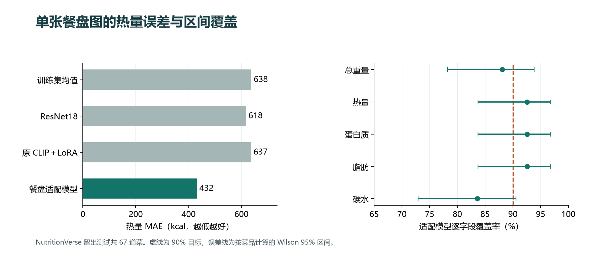

# 单 RGB 餐盘营养估计 · NutritionVerse 留出实验

2026 年 11 月 25 日，刘杰。极限挑战新增了餐盘域适配实验。在同一组 67 道留出菜品上，适配模型的五项 MAE 和 MSE 均低于训练集均值、原 ResNet18 和原 CLIP＋LoRA。热量 MAE 降低 32.18%（相对原 CLIP＋LoRA）。五项中有三项达到逐字段 90% 目标，重量和碳水出现欠覆盖。



## 四个模型在同一评估集上的 MAE

| 字段 | 训练集均值 | 原 ResNet18 | 原 CLIP＋LoRA | 餐盘适配模型 |
|---|---:|---:|---:|---:|
| 总重量（g） | 192.14 | 276.98 | 258.34 | **145.05** |
| 热量（kcal） | 637.71 | 617.73 | 636.93 | **431.97** |
| 蛋白质（g） | 40.47 | 48.65 | 48.45 | **24.86** |
| 脂肪（g） | 31.87 | 28.26 | 28.86 | **21.49** |
| 碳水（g） | 68.29 | 58.68 | 53.66 | **44.21** |

均值从本域 68 道训练菜品计算。ResNet18 和原 CLIP＋LoRA 复用 Task2 权重。适配模型在相同的 CLIP＋LoRA 视觉编码器上，用这 68 道菜拟合新的五字段回归头。该对照衡量增加本域监督和餐盘特征后的整套改动。各模型每道菜只接收同一张 RGB 图。各字段的完整 MSE、MAE、覆盖率、平均区间宽度和区间评分见 [metrics.json](metrics.json)。

按菜品配对重采样 5,000 次，适配模型相对原 CLIP＋LoRA 的热量 MAE 平均少 204.97 kcal，差值（新减旧）的 95% 百分位区间为 −334.30 至 −77.45 kcal。碳水的差值区间为 −22.31 至 +3.04 g，样本不足以清楚区分两者在该字段的优势。重采样以菜品为单位，不能反映未知烹饪批次的影响。[配对差值](paired_mae.json)

## 区间覆盖与欠覆盖案例

| 字段 | 覆盖数 / 67 | 覆盖率 | 平均区间宽度 | 未覆盖数 |
|---|---:|---:|---:|---:|
| 总重量 | 59 | 88.06% | 535.64 g | 8 |
| 热量 | 62 | 92.54% | 1,928.61 kcal | 5 |
| 蛋白质 | 62 | 92.54% | 94.68 g | 5 |
| 脂肪 | 62 | 92.54% | 96.17 g | 5 |
| 碳水 | 56 | 83.58% | 102.90 g | 11 |

在同一评估集上，原 CLIP＋LoRA 的热量区间平均宽 2,742.70 kcal，覆盖 63 道。适配模型的区间缩窄 29.68%，覆盖 62 道。1,928.61 kcal 的平均宽度仍然很大。上述比例是逐字段的实测值，五项同时覆盖的概率和单张新照片的误差需要另外估计。

例如，菜品 99 的真实热量为 3,333.86 kcal，模型估计 1,194.35 kcal，区间上界为 2,440.04 kcal。菜品 57 的碳水真值为 5.54 g，稍低于区间下界 5.62 g。前者是明显低估，后者是边界处漏覆盖。四模型共有 119 条“模型 × 菜品 × 字段”未覆盖记录，其中适配模型占 34 条。[全部欠覆盖案例](undercoverage.json)

## 如何防止校准与测试参与选型

1. 采用下载前登记的四份菜品清单。每道菜取一个固定视角。68 道用于训练，30 道用于验证，60 道预留校准，67 道预留测试。菜品 ID 和图像哈希互斥，烹饪批次关系未知。
2. 从同一张 RGB 图提取整图和自动餐盘裁剪的视觉特征。候选还可使用颜色分布和前景面积比例。用训练集标准差归一化各字段的 MAE，热量权重为 2，其余各为 1。预先固定的 12 个候选中，验证集选出“整图＋餐盘＋颜色和面积特征、平方根目标、岭回归”。训练图像与答案无需在推理时检索。[预先登记的方案](protocol.json)
3. 使用训练集五折折外残差生成两种候选区间的临时阈值，在验证集按兼顾宽度和漏覆盖惩罚的区间评分选择。验证评分从固定宽度的 2.566 降至按预测量调整宽度的 2.398。全部处理、权重和方法随后冻结。[选型与冻结记录](freeze.json)
4. 只在 60 道预留校准菜上计算每字段正式阈值。按比例缩放的绝对残差取第 55 小，目标 90%。保存阈值后，在 67 道预留测试菜上评估一次。原始预测供复算，菜品 ID 只用于关联和核验。[校准记录](calibration.json) · [测试预测](evaluation_predictions.json)
5. 原 OmniFood8K 正式结果和 MetaFood3D 结果各自对应原来的模型、划分和校准版本。上述改进只在 NutritionVerse 餐盘域获得验证。进一步选型需另设最终评估数据。

## 展示与复核

2026 年 11 月 26 日更新了餐盘展示程序。每张照片只解码一次，直接计算餐盘模型所需的整图与裁剪图特征。程序在加载阈值时记录对应的校准版本。更换校准文件后，已打开的会话继续导出原阈值和原版本，新建会话使用新文件。界面只对有匹配评估记录的校准版本显示实测覆盖率。

在本机 RTX 4060 Laptop GPU 上，用固定的 12 张训练图片各测四轮。预热后的单图中位耗时从 222.94 ms 降至 167.78 ms（降低 24.74%），第 90 百分位从 270.32 ms 降至 181.18 ms。计时包含文件解码、预测和预览图生成。12 张图的五项点预测、上下界、单位和版本逐项完全相同。此项测量评价交互速度，模型精度仍以本报告的 67 道留出测试为准。[计时口径与样本清单](display_performance.json)

解压提交包并配置项目依赖，双击包根目录的“打开餐盘优化展示.cmd”。点击“打开示例”使用固定排序的第一道留出菜品，或选一张普通 RGB 食物图。界面支持导出点预测、上下界、单位、目标覆盖率、模型版本和校准版本。原 OmniFood8K 演示由“打开营养展示.cmd”启动。

在解压目录也可以直接运行下列命令。

```powershell
python -m challenge_external.nutritionverse_model challenge_external/data_supplement_v1/nutritionverse/images/dish_36.jpg
python -m challenge_external.verify_nutritionverse
python -m challenge_external.verify_delivery
```

复核脚本检查 225 张原图的哈希、四组数据、20 组阈值与指标、全部欠覆盖字段和真实单图接口。接口可通过 `NutritionVerseSession().predict(image_path)` 调用。

图像与标签来自 NutritionVerse-Real v2，发布方 NutritionVerse，Kaggle 列出的创建者为 Amy Tai。按预先登记的规则选图，保留原图字节。数据采用 CC BY-NC-SA 4.0。[作者发布页](https://www.kaggle.com/datasets/nutritionverse/nutritionverse-real/versions/2) · [许可](https://creativecommons.org/licenses/by-nc-sa/4.0/)
