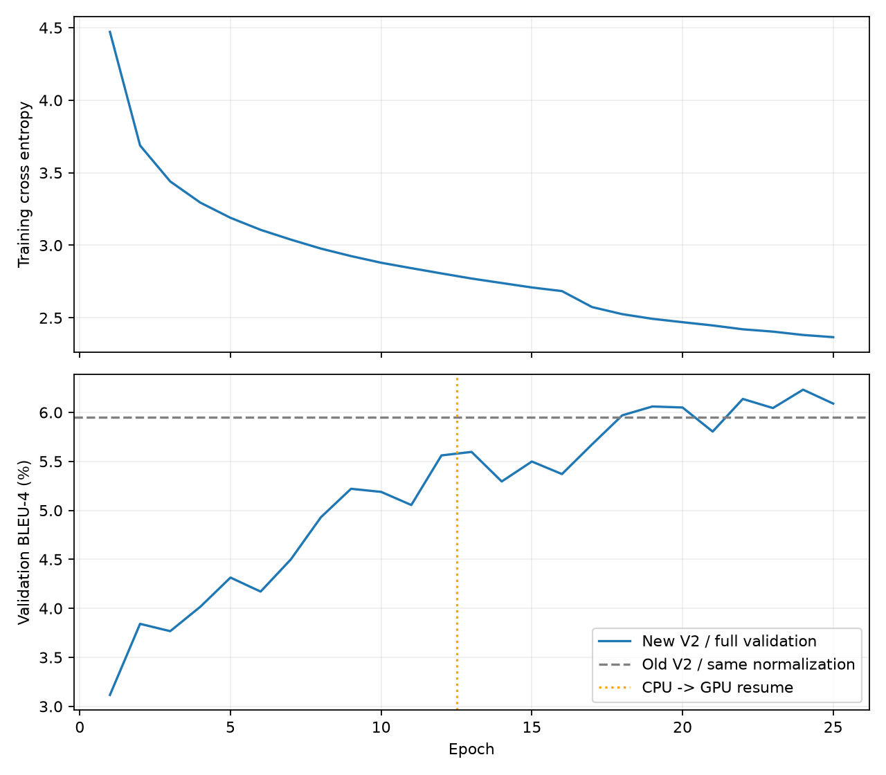

# V2词表修复重训结果

本次结论：词表/输出完整性修复有效，但不是所有指标都超过旧V2。以原小写空格分词的同一测试口径比较：

| 测试指标 | 旧V2 | 新V2 |
|---|---:|---:|
| BLEU-4 % | 5.2914 | 5.1885 |
| ROUGE-L | 0.2695 | 0.2716 |
| CIDEr-D | 0.3713 | 0.4044 |
| 含UNK描述 | 559/4938 | 0/4938 |
| 含重复三词片段描述 | 1005/4938 | 764/4938 |

在新版统一分词下，测试BLEU-4同样下降（旧5.7250%，新5.5741%），因此不能用分词口径变化声称BLEU提升。建议保留旧V2作为BLEU对照，新V2作为词表修复实验版；不依据这次测试结果继续调参刷分。

最佳轮次：24；词表4837项，只从训练集构建；没有继承旧V2训练权重。视觉骨干采用原ImageNet预训练ResNet18。

| 划分 | 模型 | 新分词BLEU-4 % | 原空格口径BLEU-4 % | 含UNK描述 |
|---|---|---:|---:|---:|
| val | 旧V2 | 5.9485 | 5.4971 | 234 |
| val | 新V2 | 6.2319 | 5.7362 | 0 |
| test | 旧V2 | 5.7250 | 5.2914 | 559 |
| test | 新V2 | 5.5741 | 5.1885 | 0 |

同一列内才是相同分词口径的对比。完整验证集选权重；测试只在训练结束后评价。单随机种子，不能声称统计显著。训练目标取消标点并延长句长，因此不是只改变词表大小的单变量实验。

最终权重：best_v2.pt；推理见predict.py；完整指标见final_results.json；训练曲线数据见history.json。

训练设备：第1—12轮CPU（torch2.2.2），第13轮起RTX4060 Laptop GPU（torch2.5.1+cu124）；从第12轮完整训练断点恢复，保留优化器与调度器。跨设备续训不声称逐位可复现。

词表覆盖改善和输出没有UNK不等于未见食物识别正确，仍需人工检查样例。重复三词统计仅为诊断，正常短语也可能重复。固定随机种子抽取20张验证样例见validation_cases20.json。

训练曲线：

